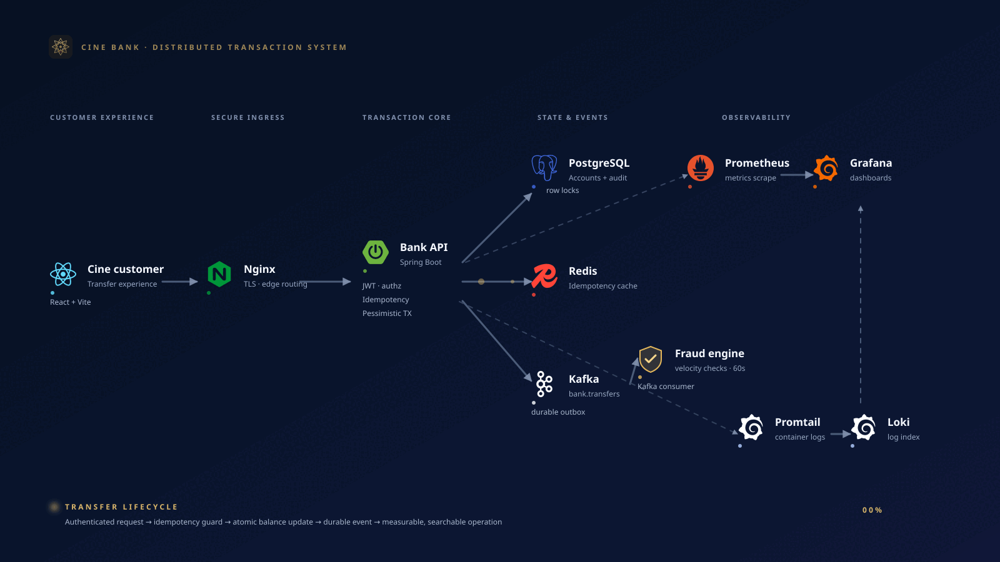
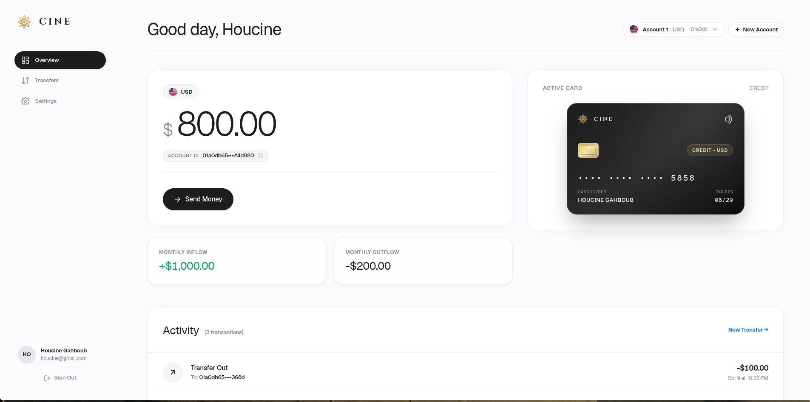
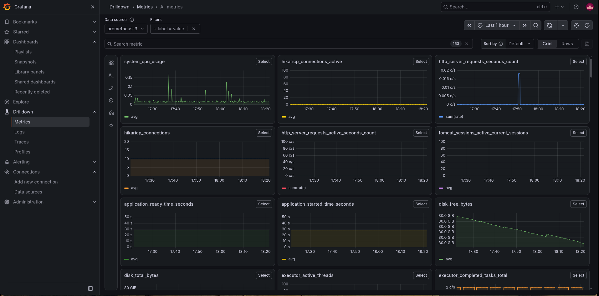

# Distributed Transaction System

A fault-tolerant **distributed transaction system** and financial ledger built with Java 21, Spring Boot 3.3, PostgreSQL 17, Redis 7, and Apache Kafka 3.8. Engineered for ACID isolation, HTTP idempotency, deadlock-free concurrency, and at-least-once event delivery.


---

## Why I Built This

I’ve built plenty of projects over the years, but they all shared the same flaw: none of them were designed to survive production. That left me with a nagging question I couldn't answer from tutorials alone: *How do production systems actually work under the hood?*

The only way to find out was to build something that would force me to confront real production failure modes head-on. That led to this distributed transaction system, which I chose for two reasons:

- **Money can never go wrong.** Financial ledgers are unforgiving. You can't shrug off a race condition, a dropped message, or a partial failure when balances are on the line.
- **Minimal business logic, maximum engineering depth.** On the surface, a transaction system is just `transfer` and `receive`, right? *(God knows how many architectural headaches hide behind those two operations.)* Keeping the domain simple let me spend 90% of my time on actual systems engineering rather than CRUD boilerplate.

Instead of hiding behind a managed PaaS that abstracts the hard parts away, I built and wired the entire stack and infrastructure myself, from database lock ordering down to raw Linux server provisioning, Docker networking, and Nginx TLS termination.

---

## Architecture & Core Engineering Decisions



### 1. Double-Click & Network Retry Protection (Idempotency)
- **Problem:** A client clicks "Send" twice in 50ms or retries after a dropped connection.
- **Solution:** [`IdempotencyFilter`](backend/src/main/java/com/houcinee/bankapp/filter/IdempotencyFilter.java) hashes `userId:method:URI:body` (SHA-256) and acquires an atomic Redis lock (`SET key fingerprint NX EX 30`). In-flight duplicates get `409 Conflict`, completed retries return the cached HTTP response with zero DB hits, and modified payloads reusing a key are rejected with `422 Unprocessable Entity`.

### 2. High-Contention Race Conditions & Cyclic Deadlocks
- **Problem:** Concurrent debits overdraft an account, or User A transfers to User B at the exact millisecond User B transfers to User A (causing a circular deadlock).
- **Solution:** [`TransactionService`](backend/src/main/java/com/houcinee/bankapp/service/TransactionService.java) uses pessimistic row locking (`SELECT FOR UPDATE`) and sorts account UUIDs lexicographically before locking:
  ```java
  UUID firstId = id1.compareTo(id2) < 0 ? id1 : id2;
  UUID secondId = id1.compareTo(id2) < 0 ? id2 : id1;
  ```
  Both threads acquire locks in the exact same order, turning a cyclic deadlock into an orderly queue. All math uses integer cents (`BIGINT`) to avoid floating-point errors.

### 3. Node Crashes Mid-Transfer (Transactional Outbox)
- **Problem:** Updating PostgreSQL and publishing to Kafka directly risks dual-write failures if the broker drops or the JVM crashes between calls.
- **Solution:** Balance updates and `outbox_events` inserts happen inside the **same PostgreSQL ACID commit**. [`OutboxRelayService`](backend/src/main/java/com/houcinee/bankapp/service/OutboxRelayService.java) streams unpublished rows to Kafka (`bank.transfers.v1`), while [`TransferEventConsumer`](backend/src/main/java/com/houcinee/bankapp/consumer/TransferEventConsumer.java) deduplicates deliveries via Redis before running sliding-window fraud velocity checks (`ZSET`).

### 4. Tamper-Proof Auditing & Database Immutability
- **Problem:** Compromised app credentials altering history, or failed transfers rolling back security audit logs.
- **Solution:** PostgreSQL PL/pgSQL triggers ([`V1__baseline_schema.sql`](backend/src/main/resources/db/migration/V1__baseline_schema.sql)) block `UPDATE` and `DELETE` on `transactions` and `audit_logs` at the engine level. [`AuditService`](backend/src/main/java/com/houcinee/bankapp/service/AuditService.java) uses `@Transactional(propagation = Propagation.REQUIRES_NEW)` with sequential **UUIDv7** keys so failed attempts persist even when the main transaction rolls back.

---

## Interface & Live Observability

Every request is stamped with an `X-Correlation-ID` at the Nginx edge, propagated through Spring Boot structured JSON logs (Promtail → Loki), and tracked via Micrometer/Prometheus metrics.

### Application Dashboard


### Grafana Telemetry & Loki Logs


---

## Testing, Self-Managed Infrastructure & Deployment

- **Self-Managed Linux Infrastructure & Edge TLS:** Provisioned a raw ARM64 Ubuntu VM on Oracle Cloud from scratch rather than using a managed PaaS. Configured Nginx at the edge for SSL/TLS encryption termination, Layer 7 rate limiting, strict security headers, and isolated internal Docker networking across all 10 services.
- **Automated ARM64 CI/CD Pipeline:** GitHub Actions ([`ci.yml`](.github/workflows/ci.yml)) runs the full verification suite, compiles native `linux/arm64` images via Docker Buildx, and deploys over SSH to the production server.
- **Real PostgreSQL Integration Tests:** 184 tests run against a singleton **Testcontainers** PostgreSQL 17 instance ([`BaseIntegrationTest`](backend/src/test/java/com/houcinee/bankapp/service/BaseIntegrationTest.java)) in ~45s rather than faking locks and triggers with H2.
- **JaCoCo Code Coverage:** Measured via **`jacoco-maven-plugin`**, achieving **97.6% line coverage** across domain, controller, and service layer logic.
- **Bytecode Mutation Testing & Mutation Strength:** Uses **PIT (`pitest-maven`)** to inject bytecode faults (inverting boundary conditions, flipping conditionals, and altering arithmetic operators). Achieves an **85% mutation score** and **90% mutation test strength**, proving that the test suite actively detects and fails against semantic regressions rather than merely executing lines of code.

---

## Quick Start

```bash
# 1. Start the full 10-container stack (App, Postgres, Redis, Kafka, Nginx, Loki, Prometheus, Grafana)
docker compose -f docker-compose.staging.yml up -d
```

- **Web UI:** `http://localhost`
- **API Gateway:** `http://localhost/api/v1`
- **Grafana:** `http://localhost:3000`

```bash
# 2. Run the 184-test suite & PIT mutation coverage
cd backend
./mvnw clean verify
./mvnw pitest:mutationCoverage
```

For deeper context, see [`ARCHITECTURE_DECISIONS.md`](ARCHITECTURE_DECISIONS.md).